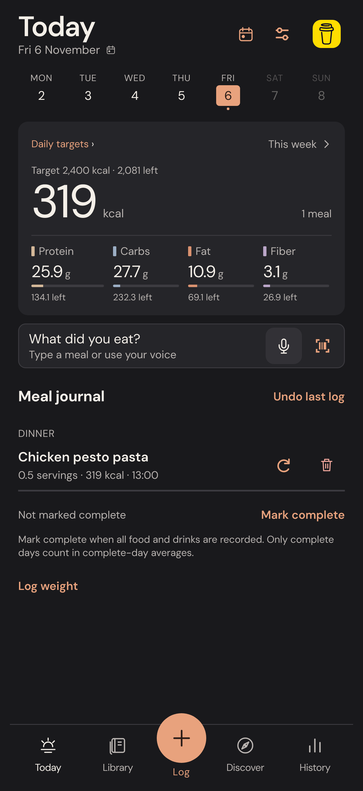
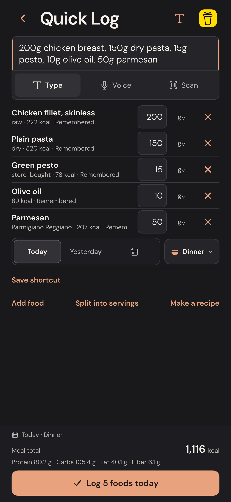
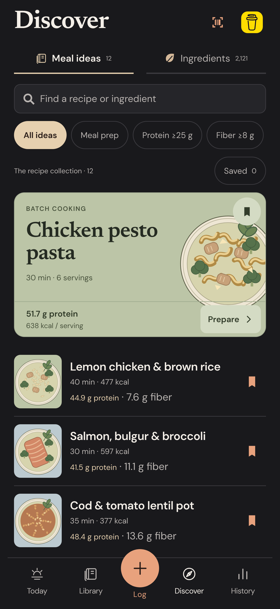

<p align="center"></p>
<h1 align="center">Touche Grasse</h1>
<p align="center">Fast meal logging. Clear nutrition. Your records stay with you.</p>
<p align="center">
  <a href="https://github.com/rolfe099-sketch/touche-grasse/actions/workflows/ci.yml"></a>
  <a href="LICENSE"></a>
</p>
<p align="center"><a href="#getting-started">Get started</a> · <a href="docs/README.md">Documentation</a> · <a href="CONTRIBUTING.md">Contribute</a> · <a href="ROADMAP.md">Roadmap</a> · <a href="https://rolfe099-sketch.github.io/touche-grasse/privacy/">Privacy</a></p>

Touche Grasse is a free, open-source food and macro tracker built with Expo and React Native. Type a whole meal, confirm the food matches inline, and log it in one action. Track calories, protein, carbs, fat and fiber, with recipes, saved portions and a meal planner in the same app.

No app account, ads, subscription or analytics SDK. Diary records are stored locally. Optional speech recognition, barcode lookup and external links have their own network behavior; see the [privacy policy](https://rolfe099-sketch.github.io/touche-grasse/privacy/).

<p align="center">
  
  
  
</p>

Screenshots show the actual shared Expo interface in WebKit with fictional records. They are not physical-device captures.

## Project status

**Development preview.** A production iOS build has been uploaded to App Store Connect. There is no public TestFlight invitation or App Store download linked here yet, and App Review submission is not claimed. You can run the source locally today.

The Expo app in [`apps/mobile`](apps/mobile) is the active implementation. The original Swift/SwiftUI code remains available as [historical reference](docs/SWIFT_PROTOTYPE.md).

## What you can do

| Workflow | Features |
| --- | --- |
| Log a meal | Natural-language typing, supported voice commands, barcode lookup, local label OCR, inline corrections and learned product choices |
| Repeat familiar food | Named meal shortcuts, remembered amounts, one-action repeats and Undo |
| Cook and save portions | Recipes, custom servings, measured cooked weights, finite portion inventory and logging by servings or grams |
| Plan ahead | Separate planned and eaten meals, retained drafts, dated plans and explicit consumption |
| Follow your targets | Optional calorie and macro goals, training/rest weekday profiles, remaining amounts and dated target history |
| Explore progress | Daily, weekly, monthly and lifetime history, optional weigh-ins and complete-day markers |
| Find food and ideas | English/Norwegian food search, 2,121 captured Matvaretabellen records and 12 original recipe ideas |
| Keep your records | SQLite on iPhone, IndexedDB in browsers, local recovery copies and validated export/merge restore |

Food calculations use decimal arithmetic and source records. Missing nutrients stay unknown. Historical nutrition snapshots survive later edits. Important raw/cooked and dry/cooked differences stay explicit; the app does not invent cooking yield, absorbed oil or extra ingredients.

## Getting started

Use **Node.js 24 LTS**, npm and Git. No backend or API key is needed for the offline diary and catalog.

```sh
git clone https://github.com/rolfe099-sketch/touche-grasse.git
cd touche-grasse/apps/mobile
npm ci
npm run web
```

Open the address printed by Expo. To choose another port, use `npm run web -- --port 8082`.

For iPhone development, read the [device guide](docs/IPHONE_TESTING.md). Direct native speech and label OCR require a native build containing their modules; Expo Go does not provide the complete experience. Never reuse another developer's LAN address or signing credentials.

## Development and checks

From `apps/mobile`:

```sh
npm run typecheck
npm run lint
npm test
npm run build:web
npm run preview
```

The exported preview runs at `http://127.0.0.1:4173`. In a second terminal, run browser checks:

```sh
npx playwright install chromium webkit
npm run test:e2e
npm run test:iphone:web
```

CI checks types, lint, unit tests, the real SQLite/IndexedDB adapters, web export, Chromium and iPhone-sized WebKit workflows. Tests use isolated synthetic diaries. Browser checks and signed-build success do not establish physical iPhone behavior; the [device checklist](docs/IPHONE_TESTING.md) records that distinction.

See [the development guide](docs/DEVELOPMENT.md) for project structure, storage rules and test scope.

## Limits to know

- Speech availability, accuracy and processing location depend on the operating system or browser. Barcode lookup requires internet access and review of the package values.
- The bundled food catalog is a dated snapshot. Packaged-food coverage and nutrient completeness vary.
- Recovery copies stay on the same device or browser origin. Export elsewhere before uninstalling, clearing storage or moving between hosts/ports. Backup files contain personal data and are not encrypted by the app.
- There is no cloud synchronization. Goal estimates are editable starting points, not automatic coaching. The planner does not reserve stock; its recipe/batch selectors currently use servings, while Library retains measured gram controls.

[Feature behavior and verification notes →](docs/README.md)

## Contributing

Bug reports, food-matching examples, accessibility improvements and focused pull requests are welcome. Start with [Contributing](CONTRIBUTING.md), the [Roadmap](ROADMAP.md) and our [Code of Conduct](CODE_OF_CONDUCT.md). The project is maintained by [@rolfe099-sketch](https://github.com/rolfe099-sketch); response times depend on availability.

Use the [issue forms](https://github.com/rolfe099-sketch/touche-grasse/issues/new/choose) for reproducible bugs and proposals. Report vulnerabilities through the [private security contact](SECURITY.md). Never post personal diary backups, recordings, credentials or signing files in public.

For app support, email [support@eriksenlabs.com](mailto:support@eriksenlabs.com). If you would like to support development, [buy me a coffee](https://buymeacoffee.com/endoftheend). Donations are optional and do not unlock features.

## License and acknowledgements

Original project code is licensed under **AGPL-3.0-only**. See [LICENSE](LICENSE) and [third-party notices](THIRD_PARTY_NOTICES.md) for the separate terms covering data, fonts, logos and dependencies.

Food composition records are attributed to **Matvaretabellen, Mattilsynet**, captured on 22 October 2026, with source IDs and provenance retained. The software license does not relicense food data. [Official data/API information](https://matvaretabellen.mattilsynet.io/en/api/).

Inspired by the community-owned approach of [openGym](https://github.com/DuarteSantos8/openGym). Touche Grasse is an independent project and is not affiliated with openGym.
