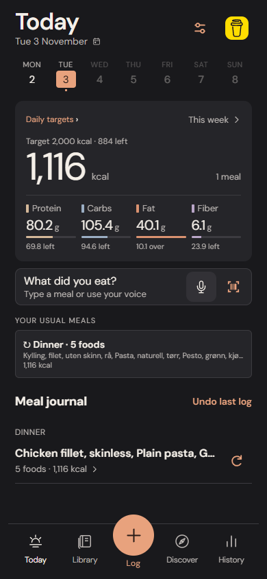
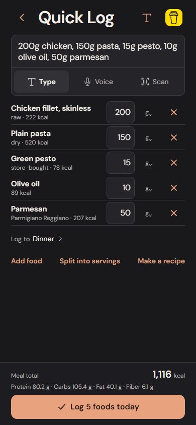

# Touche Grasse

**Fast food logging. Your data stays with you. Free and open source.**

Touche Grasse is a local-first calorie and macro tracker built with Expo and React Native. Type a whole meal, resolve the ingredients inline, and log it in one action. Foods, recipes, saved portions, drafts and history stay on your device.

No account, subscription or analytics SDK. Optional donations help support development: [Buy me a coffee](https://buymeacoffee.com/endoftheend).

<p>
  
  
</p>

Actual implementation screenshots using isolated test meals. This is an early development release, not an App Store release.

## What works

- **Quick Log:** `200g chicken, 150g pasta, 15g pesto, 10g olive oil, 50g parmesan`. Live parsing, inline quantities, relevant suggestions, learned product choices and one-action logging with undo.
- **Verified food records:** 2,121 captured Matvaretabellen foods, Norwegian and English search, aliases, explicit raw/cooked and dry/cooked distinctions. Unresolved ingredients block logging; missing nutrients stay unknown.
- **Nutrition:** calories, protein, carbohydrates, fat and fiber calculated with decimal arithmetic. Optional dated personal targets show remaining and over amounts without changing food calculations.
- **Recipes and batches:** custom servings, optional measured cooked weight, logging by servings or grams, and finite saved portions for later days. Creating a batch does not log it as eaten.
- **Today and History:** one-tap usual meals and saved portions, daily diary, corrections, daily/weekly/monthly/lifetime exploration.
- **Meal shortcuts:** name and pin verified meals on Today, log in one tap, adjust amounts before logging, or say “Log my breakfast.” Explicit day completion separates complete-day averages from partially recorded intake. [Daily workflow details](docs/DAILY_WORKFLOWS.md).
- **Meal corrections and weigh-ins:** replace/add/remove ingredients with retained history and correction Undo, including finite saved portions. Optional dated weigh-ins, observed weight trends and complete-day weekly summaries. [Details](docs/MEAL_EDITING_AND_WEIGHT.md).
- **Command and scan recovery:** multi-step cooking commands, retained interrupted speech, atomic retries and label rescans that preserve corrections. [Details and verification boundaries](docs/VOICE_AND_SCAN_RELIABILITY.md).
- **Delete and undo:** visible trash controls for entries and grouped meals. Deletion updates totals and saved-portion inventory; Undo restores exact snapshots and survives reopening. The next log/deletion replaces the single undo action; backup restoration clears a pending deletion undo.
- **Local persistence:** SQLite on native, IndexedDB in browsers; retained drafts, immutable historical nutrition snapshots, validated JSON backup and merge restore.
- **Packaged products:** barcode lookup through Open Food Facts, editable label review before saving, explicit g/ml bases, correction provenance and offline reuse of confirmed products. New scans add to the meal draft; they do not log food as eaten.
- **Recovery copies:** automatic on-device versions stored separately from the active diary, integrity checks, pre-restore copies and a Settings recovery/export flow. Existing historical entries and unfinished meals survive recovery merges.
- **Unified entry:** typing, voice controls and barcode camera entry share one review. See the runtime limits below.

## Run locally

Requirements: Git, **Node.js 24 LTS** and npm. The repository includes a lockfile. No API key or backend is needed for the core app.

```sh
git clone https://github.com/rolfe099-sketch/touche-grasse.git
cd touche-grasse/apps/mobile
npm ci
npm run web
```

Open the address Expo prints. If port 8081 is busy, run `npx expo start --web --port 8082`.

For phone development, run `npm start` and follow Expo's current instructions for your device and the pinned SDK. The project uses Expo SDK 54. **Direct native speech needs a development build** containing `expo-speech-recognition`; it is not available in Expo Go. Check runtime compatibility before upgrading dependencies.

The [iPhone testing guide](docs/IPHONE_TESTING.md) covers Windows + iPhone testing, the prepared development-build profile, and the physical-device acceptance checklist. No cloud project or signed build is created automatically.

## Test and build

From `apps/mobile`:

```sh
npm run typecheck
npm run lint
npm test
npm run build:web
npm run preview
```

The preview runs at `http://127.0.0.1:4173`. In a second terminal:

```sh
npx playwright install chromium
npm run test:e2e
```

The browser suite tests parsing, corrections, learned matches, persistence, backup restore, targets, historical snapshots, repeat/undo, portions and layout at iPhone dimensions. Tests use isolated browser contexts and synthetic diaries built from the actual catalog. CI also runs the browser export and tests.

CI checks TypeScript, ESLint, unit/storage tests, web export, Chromium workflows and iPhone-sized WebKit workflows. The owner confirmed native launch, a real food log, repeat/undo, reopen persistence, entry deletion/undo and three-row multi-ingredient speech parsing on an iPhone 13 Pro. Camera, recovery sharing and the remaining [device checklist](docs/IPHONE_TESTING.md) still need physical validation. The optional live barcode smoke is separate from deterministic API-fixture tests.

The exported web app supports an offline reload after its first successful online load. Expo's development server does not install the service worker. Browser data belongs to its origin: different hosts and ports have separate libraries. Export/restore to transfer data, and keep backups before changing origins or clearing browser storage.

## Current limits

- Physical iPhone behavior, permissions, native speech and camera scanning still require device testing. An internal iOS development build has been produced; it is not an App Store release, and native binaries are not committed to this repository.
- New barcodes require an internet connection and package review. Open Food Facts coverage and completeness vary; unsupported/prepared-only nutrition falls back to label entry. Nutrition-label scanning uses local OCR with an editable review; it needs the updated native build on iPhone. [Label scanning details](docs/LABEL_SCANNING.md). [Lookup and recovery details](docs/BARCODES_AND_RECOVERY.md).
- Voice uses platform/browser speech recognition; availability, processing location and accuracy depend on the runtime. Commands cover implemented meal/recipe operations, not unrestricted assistant behavior.
- There is no cloud sync. Recovery copies remain on the same device/origin and cannot survive uninstalling or clearing all app/site data. Export elsewhere for that. Copies and JSON exports contain personal data and are not encrypted by the app.
- The bundled Matvaretabellen catalog is a dated snapshot. Reviewed packaged records stay as confirmed until explicitly replaced; history always retains its snapshots. The app does not infer cooking yield or oil absorption.

## Repository

| Path | Purpose |
| --- | --- |
| [`apps/mobile`](apps/mobile) | Primary Expo app, domain, storage adapters, tests and build scripts |
| [`Packages/ToucheGrasseCore`](Packages/ToucheGrasseCore) | Original Swift domain and SQLite implementation |
| [`ToucheGrasse`](ToucheGrasse) | Original SwiftUI prototype, preserved for reference |
| [`Fixtures`](Fixtures) | Captured official food responses and reproducibility manifests |
| [`docs`](docs) | Integration notes, screenshots and legacy native documentation |

The Expo app is the active implementation. Root-level architecture/status documents and the [Swift prototype guide](docs/SWIFT_PROTOTYPE.md) include historical milestones and should not be read as current Expo feature descriptions.

## Contribute and support

Bug reports, matching improvements, accessibility fixes and pull requests are welcome. Read [CONTRIBUTING.md](CONTRIBUTING.md), [ROADMAP.md](ROADMAP.md) and [SECURITY.md](SECURITY.md). Never attach your personal backup or credentials to a public issue.

If Touche Grasse helps you, [buy me a coffee](https://buymeacoffee.com/endoftheend). Donations are optional and do not unlock features.

## License and attribution

Original project code is licensed under **AGPL-3.0-only**; see [LICENSE](LICENSE). Modified versions conveyed to others, and modified versions used to interact with users over a network, carry the license's source-sharing requirements. Third-party data, fonts, logos and dependencies retain their own terms; see [THIRD_PARTY_NOTICES.md](THIRD_PARTY_NOTICES.md).

Food composition data: **Matvaretabellen, Mattilsynet**, captured 22 October 2026, with source identifiers and provenance preserved. [Official API documentation](https://matvaretabellen.mattilsynet.io/en/api/) requests attribution and describes local caching. The software license does not relicense that data.

Inspired by the community-owned approach of [openGym](https://github.com/DuarteSantos8/openGym). Touche Grasse is independent and is not affiliated with openGym.
