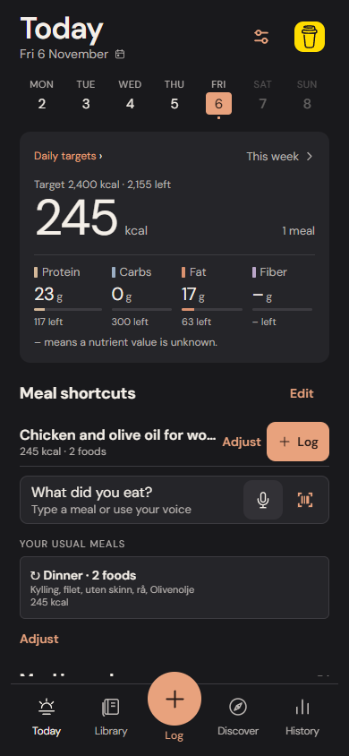
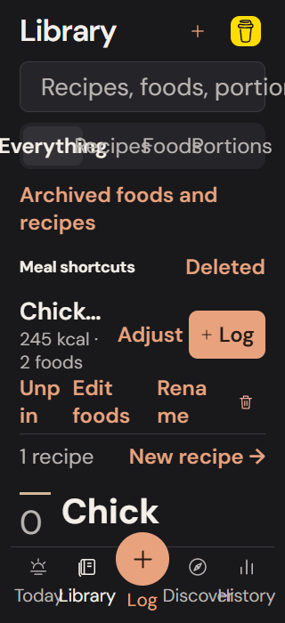
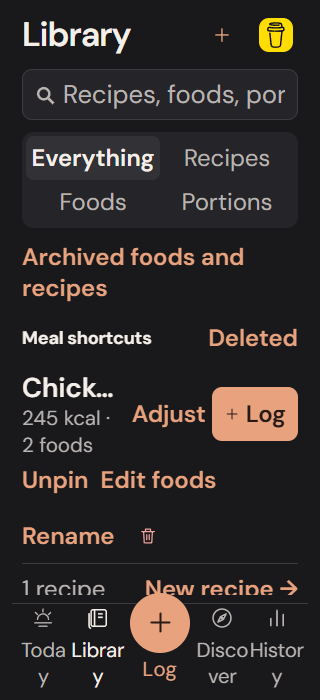

# Accessibility and keyboard finish

This pass preserves the approved visual identity, five navigation destinations and single-action logging. It changes presentation, target sizes, labels and input behavior; nutrition math, source records, storage formats and historical snapshots are unchanged.

## Implemented

- Discover and Library have a shared search field with a 44-point input, an outer focus outline and a 44-point clear action. Clearing retains focus; Search dismisses the keyboard. Neither page opens the keyboard automatically.
- Today and shared nutrition summaries expose one named reading group per macro, including fiber. Unknown values, an empty diary, recorded zero, targets and over-target amounts have different descriptions. Decorative duplicate text and progress tracks are hidden from assistive reading inside each noninteractive group.
- Nutrient grids use two columns at narrow widths or larger native font scales; target, weight and correction forms give their inputs full rows. Fonts are not clamped. The ordinary 390-point layout keeps its compact grid.
- Navigation labels can wrap. The central plus remains the same Log action, with one reading label rather than an extra decorative Log stop. Selected tabs, saved foods and favorite recipes expose their state.
- Food actions use the same English product label displayed on screen. Recipe editing has a descriptive action name. Norwegian queries and original food records are retained.
- History's open-day action and recipe unit changes have at least 44-point targets. The Today day strip can scroll locally when needed rather than shrinking day targets below 44 points.

## Evidence

The isolated baseline export failed four explicit checks: nutrient summary groups were missing, both search inputs were 28 points high, and History's open-day action was only 32 points wide. The audit uses synthetic records from the verified catalog, including a deliberately missing legacy fiber value. No personal diary or backup is used.

`e2e/accessibility-finish.spec.ts` records actual browser screenshots at 390×844 and runs narrow-layout checks at 320×700. A separate 1.7× CSS text stress check catches browser collisions; it is not an iOS Dynamic Type simulation. Domain tests exercise native width/font-scale layout choices and distinguish unknown, empty and zero nutrient values.

Local checks: 366 domain/storage tests pass; TypeScript passes. All three focused Chromium workflows pass, including export comparisons proving unchanged logs, targets and historical snapshots after canceled editing. The complete browser regression results are recorded in the draft PR and CI artifacts. Native results remain pending as described below.

## Physical checks still required

Browser accessibility trees do not establish VoiceOver announcement order, rotor behavior, native focus restoration or actual Dynamic Type rendering. Check those on the owner's iPhone with larger text enabled, especially the day strip, tab labels, numeric Done toolbar and keyboard avoidance. This pass does not require a new native module or a standalone build.

## Actual implementation screenshots

Ordinary 390×844 layout:

320×700 with a separate 1.7× browser text stress pass, before and after:

These are browser captures of the application with isolated catalog fixtures. They are not device screenshots or mockups.
