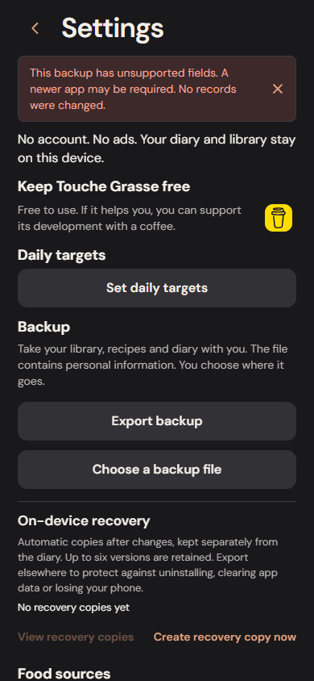
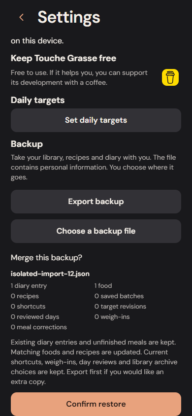

# Backup restoration and upgrade safety

The backup format stays at version 2 and the storage schema stays at version 2. This pass strengthens validation and preserves supported older records; it does not replace the diary or recalculate historical nutrition.

## Reject data that cannot be preserved

Previously, schema parsing silently stripped unrecognized backup fields, and startup ignored unknown stored record kinds. Regression tests reproduced both behaviors in the SQLite and IndexedDB adapters.

Import now compares the original archive with the parsed structure before any merge. Unsupported fields at any depth are rejected with a concise explanation instead of being silently discarded. Explicit future archive versions request a newer app. The selected file stays unchanged.

Startup checks record kinds, canonical keys, singleton slots and record identities, and refuses unsupported fields. A failed startup closes its database handle. Saved-portion capacity is checked before creating first-use metadata. No invalid or unsupported record is deleted or repaired automatically; use a compatible app version for unsupported data.

## Validate before confirmation

File restore and on-device recovery review use the same complete archive validator as restoration: record shapes, identities, food/recipe values, historical nutrition calculations and saved-portion consistency. A damaged file does not produce a misleading Confirm restore action. Selecting an invalid replacement also clears the previous proposal.

The restore API validates before creating a pre-restore recovery copy. The actual merge remains serialized and atomic; it checks combined portion inventory and preserves existing diary snapshots and local unfinished work. A failed transaction leaves both memory and stored records unchanged, including Undo, and can be retried.

## Keep older data usable

Missing legacy fiber stays missing and unknown. Supported old correction trails that contain complete entry identities now retain those IDs rather than losing them during parsing. Unfinished meal, recipe, label, voice and weigh-in drafts keep their editable strings, including decimal commas and intentionally blank nutrients.

Tests upgrade real version 1 SQLite and IndexedDB stores containing old snapshots and incomplete drafts. Their stored record values remain unchanged after the existing version 2 migration. Another disk-backed SQLite check verifies that a refused unknown record closes the actual desktop database handle and remains on disk with the same revision and payload.

## Verification boundaries

The pre-fix baseline failed four regression checks across the two adapters; an isolated browser also accepted unsupported fields into the restore proposal. New browser scenarios cover early rejection, intact diary/draft/Undo, repeated legacy imports, unknown fiber, reload and a real IndexedDB transaction abort followed by retry without duplicates. API and browser files are synthetic catalog fixtures, never personal backups.

The new focused Chromium workflows passed. Final counts and the complete Chromium/WebKit results are recorded in the draft PR and CI artifacts. Local C: storage filled during two disk-persistence tests; those cases passed when verification temporary files were redirected to D:. The local WebKit/static attempts also encountered memory failures and are not counted as full passes. No user files or diary data were removed.

Desktop SQLite, IndexedDB and automated browser results do not establish a physical iPhone restore, Files permissions or behavior during an iOS upgrade. The owner has confirmed backup creation, Files export and file-review counts; full native restoration remains pending in [the iPhone checklist](IPHONE_TESTING.md). Standalone builds remain postponed.

## Actual implementation

Unsupported contents are rejected before a restore can be confirmed:

An interrupted transaction leaves its reviewed proposal available to retry:

