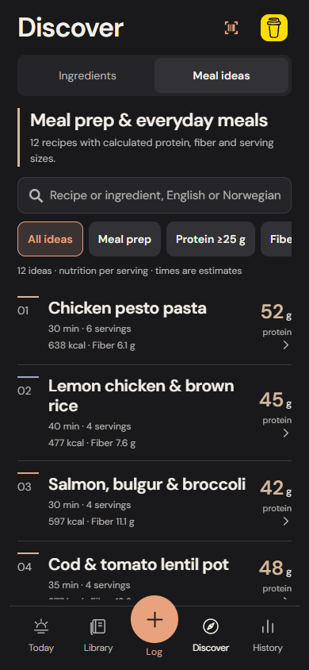
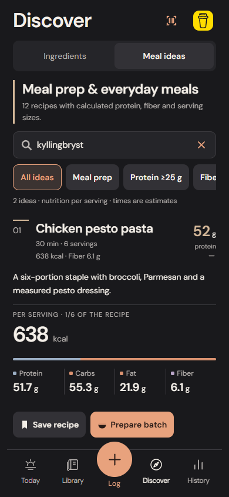

# Discover and original recipe ideas

Discover has two paths: Ingredients and Meal ideas. Both work from bundled data without an account or recipe-service API. The existing Today, Quick Log, Library and History workflows remain in place.

## Ingredients

Nine category controls browse a deliberately curated set of common ingredient records: the overview, meat, fish, grains, dairy/eggs, vegetables, fruit/berries, pulses/tofu and oils/nuts. This is an ingredient-picks collection, not an exhaustive classification of the 2,121 source foods. English/Norwegian search still covers the full food index, including personal products and existing learned-match priority.

Nutrition filters accept minimum and maximum values for calories, protein, carbohydrate, fat or fiber. Sorting offers protein/fiber descending and calories ascending. A selected per-100-g or per-100-ml basis prevents comparing unlike reference units; unknown values cannot satisfy a limit. Search filtering operates on all candidates before displaying results, rather than truncating to 50 and losing valid matches. Ordinary quick-entry searches keep their previous 50-result contract.

Tap a food name to add the usual 100 reference units directly to Quick Log. The adjacent disclosure opens adjustable amounts, all five nutrients and the exact source inline. Adding appends to the current draft; it does not mark food as eaten. Saving a food uses the existing Library persistence.

## Meal ideas

The first collection contains 12 original recipes: chicken pesto pasta, lemon chicken/brown rice, salmon/bulgur, cod/lentils, beef/lentil pasta, tofu/lentils, Greek-yogurt oats, banana cottage-cheese oats, spinach/potato egg bake, tuna pasta salad, a quark bowl and a lentil/bulgur vegetable pot. It includes meat, fish and plant-based meals, plus three breakfasts. Cooking times are editorial estimates; the recipes have not been kitchen-tested.

Each ingredient refers to a specific captured Matvaretabellen record, an explicit gram quantity and a preparation state. Raw meat, dry pasta/grains/lentils, canned tomatoes including juice and drained tuna are kept distinct. Oil is an explicit ingredient with a measured amount. Drinking/cooking water adds no macros. No unspecified cooking fat, cooked yield or absorption is inferred.

The existing decimal `recipeTotal` and `recipePortion` functions calculate calories, protein, carbs, fat and fiber. Missing records fail collection validation instead of invoking approximate search. Missing nutrients remain unknown. The bundled recipes do not contain a final cooked weight. Gram portions require a user-measured weight in an editable copy/batch.

Filters offer meal prep, breakfast, at least 25 g protein per serving, at least 8 g fiber per serving and at most 30 minutes. Nutrient thresholds use decimal comparisons. These are explicit values, not a universal health score. Recipe and ingredient-name search supports both English and Norwegian; preparation steps and interface text are English.

## Personal copies and batches

Save recipe creates a separate editable Library recipe with its own ingredient identities. Its stable versioned source-copy ID makes concurrent/repeated saves idempotent. Returning to Discover never overwrites an edited or archived copy. Published details continue to show the original recipe; Open saved copy opens the user's version, including any retained editor draft.

Prepare batch first obtains that personal copy, then opens the existing recipe route in a compact meal-prep mode. The batch name, servings, optional measured cooked weight and Save batch action appear immediately, rather than below the full ingredient list and method. Edit recipe opens those existing controls. Existing recipe edits and unfinished editor drafts take precedence. Saving a batch records finite stock without creating a diary entry. Logging a portion uses the existing snapshot, capacity validation and Undo. Recipe edits after batch creation cannot change that batch or eaten history.

These copies use the existing recipe records, backup/recovery and archive validation. No archive/storage schema change, catalog modification, cloud database, analytics, native dependency or standalone build is introduced.

The native barcode camera import is isolated behind a platform module. Expo Camera's web QR module otherwise starts a CDN-backed worker on import, even when no camera is displayed. Browser typing and manual barcode/label entry no longer load that unused worker; native camera capture and its permission lifecycle are unchanged.

## Editorial sources and contributions

The varied collection takes its ingredient-selection direction from [Norway's dietary guidance](https://www.helsenorge.no/kosthold-og-ernaring/kostradene), including vegetables, whole grains, legumes and fish. It is general meal inspiration, not a medically tailored diet. Nutrient provenance remains attached to each listed food.

Cooking instructions reference [FoodSafety.gov's minimum internal temperatures](https://www.foodsafety.gov/food-safety-charts/safe-minimum-internal-temperatures). Storage notes link to [Mattilsynet's storage guidance](https://www.mattilsynet.no/mat-og-drikke/forbrukere/rad-for-oppbevaring-av-mat); there is no universal fridge-life promise. The rice/pasta warning follows [Mattilsynet's explanation of heat-stable toxins](https://www.mattilsynet.no/mat-og-drikke/forbrukere/kokt-ris-og-pasta-som-star-fremme-kan-lage-giftstoffer).

To contribute, add original text and exact food IDs/weights to `apps/mobile/src/domain/recipeIdeas.ts`, identify raw/dry/drained states in the first step, include all caloric ingredients, and run the collection and workflow tests. Do not paste copyrighted recipes, attach speculative nutrition, advertise unverified allergens/dietary guarantees or invent cooked weights. Meaningful changes to a published recipe need a new source version; existing personal copies and history remain snapshots.

## Verification

Domain tests cover source identity, missing-record rejection, exact six-serving calculations, language search, per-serving filters, unknown values, reference units and searching beyond the previous 50-result boundary. Both production storage adapters are exercised for idempotence, concurrent saves, corrected copies, backup/restore, snapshot preservation and failed-write rollback.

Browser tests exercise ingredient browsing/filtering, inline amount changes, appending to a current Quick Log, recipe search, saving/editing/reloading copies, preparation, exact portion logging/Undo, offline saves and 320-pixel enlarged-text access. Screenshots use actual isolated app data. Browser WebKit is separate from physical iPhone acceptance; native keyboard comfort, cooking practicality and taste remain unverified.

The basic route from Discover is two taps to save a recipe, four to save a batch and five to log its first portion, excluding optional edits. The measured first-recipe path requires no scrolling at 390×844 in Chromium and 393×852 in WebKit. The browser report records actions and whether their targets require scrolling; it does not measure human completion time or the native keyboard.

## Actual implementation

