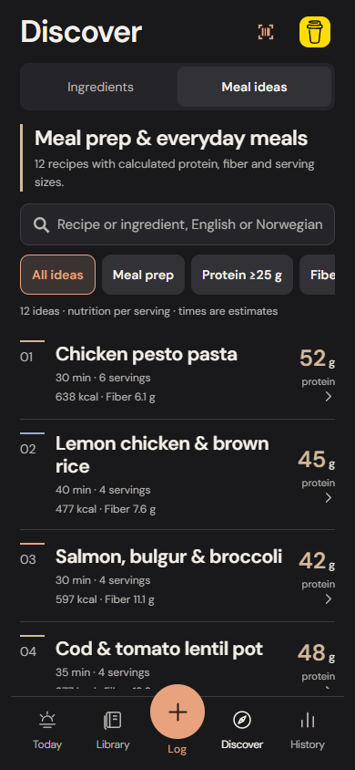
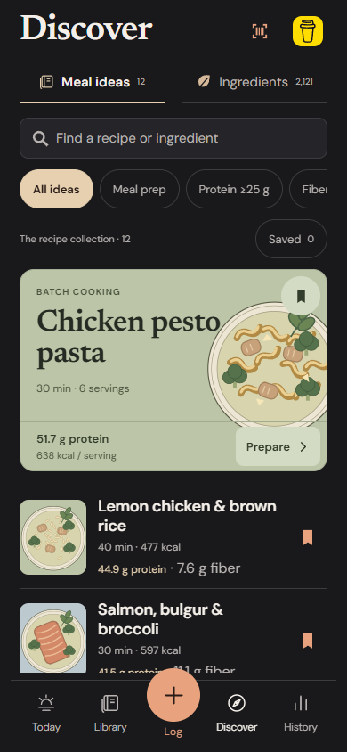
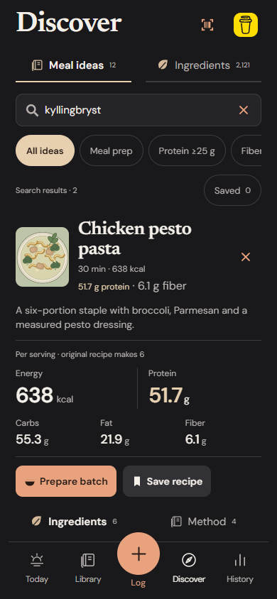

# Discover: cookbook composition and faster actions

Discover now opens on Meal ideas. The initial implementation put a recipe list behind the ingredient-search landing and repeated the same numbered row throughout. This pass changes the composition and interaction path while keeping the existing food records, recipe content, nutrition engine, personal copies, history and storage contracts.

## Composition

- Newsreader display typography pairs with the existing DM Sans controls. Charcoal and warm cream remain consistent with the rest of the app.
- An illustrated featured recipe leads the collection. The artwork is original SVG code, bundled offline, not a photograph or a claim about how a prepared meal will look. It introduces no remote images, raster generation, shading filters or new dependencies.
- Subsequent recipes use compact illustrated rows with actual calories, protein and fiber per serving. Category and nutrition controls use smaller outlined chips; recipe/ingredient navigation uses an underline rather than another filled card.
- Opening a featured recipe replaces its cover with a compact review heading. Nutrition emphasizes energy and protein, then carbs, fat and fiber. Ingredients and Method have separate inline tabs, keeping preparation instructions out of the amount review until requested.
- Expanded food details use the same nutrition language, an editable reference amount and a direct Add action. Raw/dry/cooked wording and source links remain explicit.

No Today, Library, Log, History or bottom-navigation redesign is included. The top-right donation control is preserved.

## Working actions

The featured recipe exposes Save and Prepare immediately. Saving uses the existing idempotent Library-copy transaction; preparing uses the existing compact batch review. Existing copies and their unfinished edits take precedence. No action silently marks a batch as eaten.

Saved filters the published ideas to those with personal Library copies. It does not replace published ingredient nutrition with edited private values. Published details say original recipe; Open saved copy opens the user's version. The personal Library remains the place to edit names, amounts, products and cooked weights.

Ingredient search remains available through Ingredients, with an explicit `/search?view=ingredients` route for direct ingredient intent. Existing quick-add behavior, quantity edits, per-100-g/ml filters, bilingual matching and source visibility are retained. Opening a recipe or food detail dismisses the search keyboard without clearing the query.

## Interaction measurements

From the initial Discover landing, excluding optional edits:

| Action | Initial implementation | Overhaul |
| --- | ---: | ---: |
| Save featured recipe | 3 taps including Meal ideas | 1 tap |
| Prepare and save featured batch | 4 taps | 2 taps |
| Log its first serving | 5 taps | 3 taps |
| Open full review, then save a batch | 4 taps | 3 taps |

The direct and reviewed paths are checked for target visibility at 390×844 Chromium and 393×852 WebKit. Counts are browser actions, not measured human completion time or a physical iPhone keyboard test. Opening the full review remains available before any save/prepare shortcut.

## Verification and boundaries

Existing recipe-domain and storage tests continue to protect exact source identities, raw/dry/drained weights, decimal calculations, idempotent copies, edited-copy retention, backup/restore, batch stock and Undo. No recipe quantity, nutrient record, database migration or archive version changes in this pass.

Browser coverage includes recipe-first landing, direct Save/Prepare, saved-idea filtering, ingredient/method tabs, English/Norwegian search, quantity editing, exact one-sixth logging, Undo, offline saves and enlarged-text access at 320 pixels. The existing food-search, History, keyboard and design regressions explicitly choose Ingredients where their intent is food search.

At narrow widths or larger native text sizes, the featured artwork gives way to the compact row layout. All actions retain at least 44-point targets; motion uses the existing reduced-motion-aware reveal. Native VoiceOver, Dynamic Type and keyboard comfort require physical acceptance. Original recipe cooking times remain estimates and kitchen testing remains outstanding.

## Actual browser screenshots

Before:

After:

