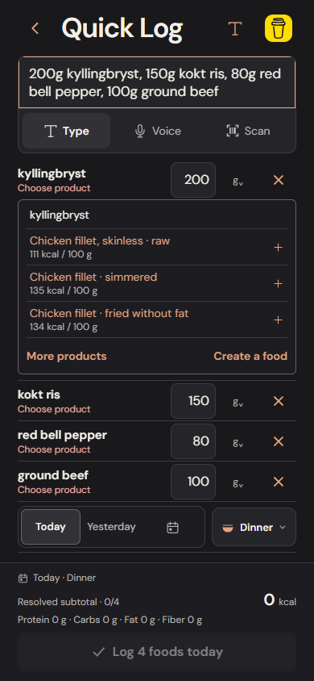
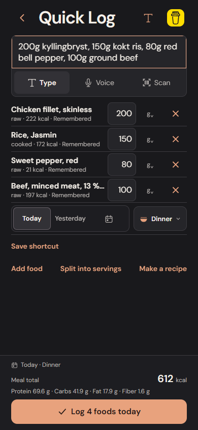

# Everyday food matching coverage

This pass addresses reproduced searches against the bundled Matvaretabellen catalog. It adds no food records, nutrient values, remote services or diary migrations.

| Query | Before | Current behavior |
| --- | --- | --- |
| ground beef | Round steak from a fuzzy match on “ground” | Raw minced beef records, with fat percentages visible |
| minced beef | Meat mixture with added starch first | Plain beef mince first |
| kyllingbryst | No results | Chicken breast fillet suggestions |
| kyllingfileter | Compound/plural fallback | Chicken fillet suggestions |
| bell pepper | No results | Raw sweet peppers, with colour visible |
| red bell pepper | No results | Raw red sweet pepper first |
| kokt ris | Rice noodles first; roasted chestnuts included | Cooked rice grain first; no uncooked pre-boiled rice |

## Search and confirmation remain separate

Phrase equivalents are a search overlay, not exact aliases. They do not silently choose a colour, cut, fat percentage or preparation. First-time generic queries remain unresolved until the user selects a verified record. Confirmed choices retain priority for that exact query after reload and remain editable.

Complete words and simple English plurals take priority over prefix collisions. Prefixes still work while typing, typos remain suggestions, saved-only search stays scoped to saved records, and corrected names invalidate cached results. Whole peanuts remain reachable before peanut butter/oil for the generic ingredient query.

## Preparation safety

An explicitly raw/dry query cannot resolve a known cooked record, and an explicitly cooked query cannot resolve a known raw/dry record. This also guards remembered choices. “Pre-boiled, uncooked” is still a dry-weight source record. The existing guard against unlisted cooking oil, butter, coated products and prepared dishes stays in place. No cooking yield, absorption or density conversion is introduced.

## Verification

Regression tests inspect the actual source descriptions and expected catalog identities, rather than merely checking for nonempty results. Browser tests use a four-ingredient English/Norwegian meal to verify sequential product choices, source-based live totals, learning after reload, independent amount edits, a preparation change, logging and Undo. Discover uses the same index without adding anything to the diary.

At 390 × 844 in desktop Chromium, the four-ingredient meal required 7 actions on first entry (open Log, enter text, confirm four products, log), then 3 actions on return (open, enter, log). Both required 0 user scrolls. The selected records total exactly 612.3 kcal, 69.64 g protein, 41.91 g carbohydrate, 17.86 g fat and 1.6 g fiber before display rounding.

Interaction measurements and actual screenshots are saved under the CI food-matching artifacts. Focus, full-string entry and button taps are separate actions; scrolling is counted separately. Browser elapsed time is not a physical iPhone completion-time measurement.

## Remaining limits

This is a bounded set of observed search failures, not exhaustive Norwegian product or synonym coverage. Brand-specific products still need barcode/provider data or a user-confirmed label. “Mager kesam”, for example, is not mapped to a fat percentage by guessing a product identity. Generic mince and peppers still require a first-time choice because their fat content, preparation and colour differ. Physical iPhone speech recognition, keyboard behavior and timing are separate checks.

## Actual browser screenshots

First-time inline product choice:

Remembered products remain editable:

