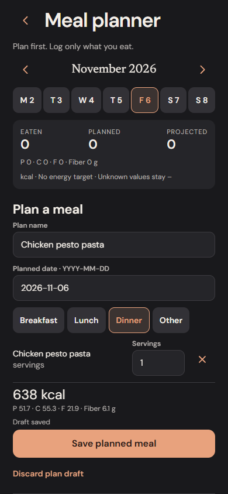
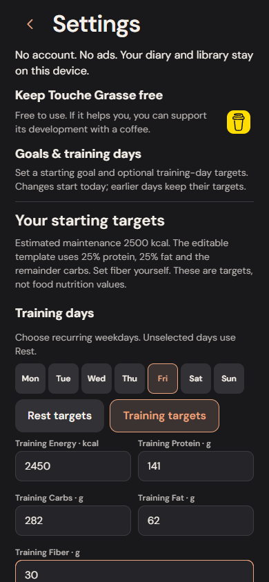

# Goals, training days and meal planning

This milestone adds optional goal setup and recurring target profiles, plus planned meals that remain separate from eaten food. It uses the existing local storage, source records, decimal calculations and single Undo action. No account or new service is required.

## Goals

Settings → Goals & training days opens a cut, maintain or gain setup. Enter your own estimated maintenance energy, or explicitly choose the optional body-measurement calculator. Review and edit all five targets before saving. Blank means no target, including fiber. A goal weight is optional and informational; it does not trigger calorie changes.

The calculator implements the original [Mifflin et al. 1990 resting-energy regression](https://pubmed.ncbi.nlm.nih.gov/2305711/): `9.99 × kg + 6.25 × cm − 4.92 × age + 166 × sex − 161`, with explicitly selected male/female coefficients. A visible, editable activity multiplier is a heuristic applied to resting energy, not measured expenditure. The calculator supports the study's adult age range of 19–78 and requires an adult/not pregnant or breastfeeding acknowledgement. It does not implement the [NIDDK dynamic Body Weight Planner](https://www.niddk.nih.gov/health-information/weight-management/body-weight-planner).

Cut/gain defaults to an editable 10% maintenance adjustment, supported from 0–20%. Maintain uses 0%. Supported estimated energy is 1,000–10,000 kcal; these bounds are input limits, **not a claim that a particular intake is adequate**. Existing manual target entry remains available. Estimates are not adaptive coaching.

The starting macro template assigns approximately 25% protein, 25% fat and the remainder carbohydrate; rounded protein/fat leave exact quarter-gram carbs so 4/4/9 sums to the chosen energy. This is an editable product template, not an individualized prescription. [Health Canada's adult reference ranges](https://www.canada.ca/en/health-canada/services/food-nutrition/healthy-eating/dietary-reference-intakes/tables/reference-values-macronutrients.html) provide the general context. Fiber is never invented.

Choose recurring training weekdays (Monday-based). None are assumed. Rest and Training start with the same values and can be edited independently. Today, History and the planner resolve the profile for each actual calendar day. Saving a new program starts today; earlier days retain their old dated context. Later manual targets override a schedule until another dated change. Historical program versions remain in goal history and exports.

## Meal planner

Open the calendar action in Today's header. The week strip can explore past and future weeks. Separate **Eaten**, **Planned** and **Projected** totals include all five nutrients, with unknown values retained. A target is displayed for the selected date.

Choose an existing personal recipe, one of the original meal ideas, saved portions, a named usual meal, foods from bilingual search, or all resolved ingredients in the current Quick Log draft. Planning a Quick Log meal leaves its original draft intact. Discover recipe details and Library recipes also offer Plan actions. A retained open plan takes precedence over incoming recipe shortcuts.

Plan name, calendar date, meal and each amount are editable together. Partial dates and amounts are retained in the on-device draft. The Save action requires a valid date, positive quantities and a nonempty name. Confirmed storage acknowledgement is shown before a hard reload is safe. Saving a plan adds **no diary entry** and consumes **no stock**.

Pending plans appear on Today for their date and can be logged in one action. Future plans offer explicit **Eat today** rather than silently recording future intake. Earlier plans offer an explicitly dated logging action. Each action atomically saves all food snapshots, a consumption receipt and Undo. Undo removes those entries and reopens the plan. Repeated requests cannot duplicate the meal.

Editing or cancelling a pending plan never changes eaten food. Logged plans link to History for existing corrections. Cancellation is reversible, retained and protected from older backup resurrection. A pending edit must be finished or discarded before logging the saved plan.

Saved-portion plans retain their batch identity and recipe snapshot, and cannot mix unrelated ingredients into that same stock-backed plan. Inventory is rechecked when eaten; it is neither reserved nor subtracted while planning. Future plans may exceed current stock and then require adjustment if insufficient portions remain. Recipe plans are ideas to prepare, while portion plans refer to actual prepared stock. Recipe gram logging still requires an explicitly measured cooked weight. No yields, added cooking ingredients or oil absorption are inferred.

## Persistence and compatibility

Goal programs and meal plans are new families in the existing atomic record store and optional version-2 archive lists. Planner drafts use a compare-and-set identity and consumed/reset marker. New app versions read old archives without backfilling historical nutrients. Older strict app versions must be updated to read backups containing the new families; they reject unsupported data rather than silently dropping it.

Restore preserves local dated target context and local plan edits/cancellations, while unioning consumption receipts. That additive evidence prevents restoring an older pending copy alongside eaten entries from authorizing a duplicate plan log. Recovery summaries include goal revisions, meal plans and unfinished planner drafts. Failed transactions leave the plan, diary, inventory and Undo unchanged.

## Interaction accounting

One interaction is a tap, field fill or selection; typing characters and automated waiting are excluded. Browser tests execute these actual controls.

| Flow | Before | Now |
| --- | --- | --- |
| Plan a recipe from Today, keeping its defaults | Unsupported | 3 taps: planner, recipe, Save |
| Log a saved plan from Today | Unsupported | 1 tap after the row is visible |
| Undo that consumption | Unsupported | 1 tap; plan becomes available again |
| Change one planned amount | Unsupported | 3 actions: Edit, amount fill, Save |
| Log a future plan as eaten today | Unsupported | 1 explicit Eat today action from the planner |
| Ordinary resolved Quick Log / saved portion | Existing one-action logging | Unchanged |

The planner is an optional additional route, not a sixth navigation destination. Source browsing and setup may scroll. Goal setup has explicit review because an estimate is not a confirmed personal target. Pending plans follow Ready to eat on Today so the existing saved-portion action stays in place.

## Verification and limits

Domain tests cover the equation, target precedence, weekdays, exact totals, unknown nutrients, partial drafts and consumption receipts. Shared repository tests exercise real SQLite and IndexedDB adapters, reopen/export/restore, failed commits, stock limits, duplicate requests, old-copy merges and Undo. Browser tests cover both guided paths, scheduled/manual targets, recipe planning, draft restart, date intent, edits/cancel/restore and narrow layouts.

Actual iPhone acceptance of these new interfaces remains pending. This milestone does not add automatic expenditure estimation from weight trends, per-date training overrides, stock reservation, grocery lists, recurring plan templates, drag-and-drop scheduling, external recipe imports, cloud sync or notifications. Existing physical-device confirmations for earlier features do not establish these new flows.

## Actual implementation screenshots

Captured in an isolated browser diary at 390 × 844, with no personal data.

