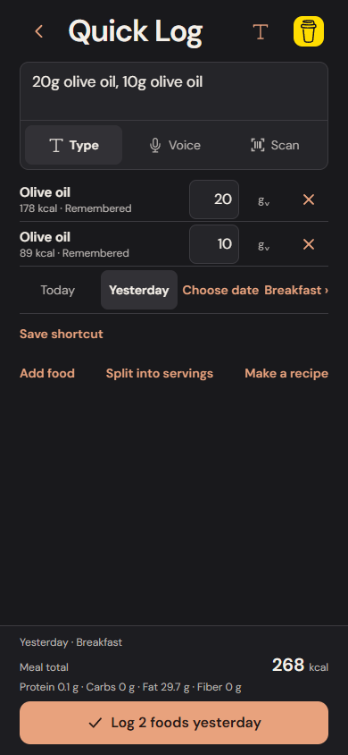
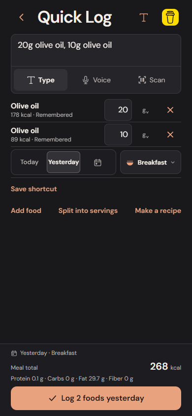
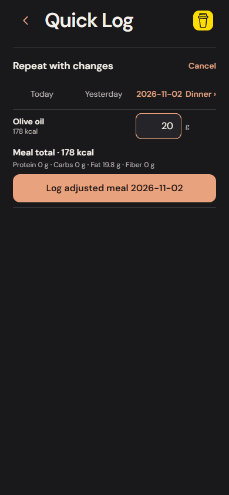
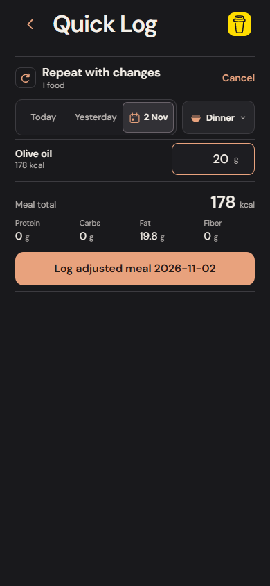

# Logging controls and whole-meal corrections

This milestone improves the newly added destination/repeat controls, then closes a practical logging gap: correcting the day or meal of several ingredients together.

## Control language

Date choices share a compact inset control; the meal selector has its own outlined control and original bowl pictogram. Selected, pressed, expanded and focused states use solid surfaces and fine borders. The inline calendar uses the same warm selection treatment. Motion respects Reduce Motion. Controls keep at least 44-point touch targets and wrap on narrow or larger-text layouts.

Repeat quantities keep their units within the same control, with one clear focus boundary. Calories and the four tracked macros have a consistent hierarchy. Draft date conflicts use a shared inline treatment with an explicit Use date / Keep draft date decision.

These are actual implementation screenshots with isolated test meals:

| Before | After |
| --- | --- |
|  |  |
|  |  |

[Inline calendar](images/logging-calendar.png) · [Whole-meal editor](images/whole-meal-move.png)

Ordinary resolved logging remains three interactions from Today: Log, enter the meal, Log food. Yesterday adds one tap. A different meal takes two taps the first time and is remembered. All five quantities and relevant suggestions in the existing ambiguous five-ingredient scenario remain visible at 390 × 844.

## Correcting a whole meal

In the journal, expand a grouped meal and choose **Edit meal**. The existing editor now includes the day and meal controls. One Save meal correction applies the chosen destination to every selected entry. Moving to another day opens that day in History; an ingredient-only or meal-only correction preserves the existing return context.

For a five-food meal in the collapsed Today journal, moving it to yesterday’s Lunch takes six interactions: expand, Edit meal, Yesterday, open meal choices, Lunch, Save. This replaces individually correcting the date and meal of each ingredient. The measurements count taps or completed text entry, not human completion time.

Changing only the date preserves each original meal type. Changing only the meal preserves exact timestamps. Mixed original destinations remain unselected until an explicit choice is made. Keep original day and meal removes the override; Discard edit leaves the diary untouched. Saving a no-op closes the editor without creating correction history or replacing the prior Undo.

## Accuracy and persistence

- Destination-only corrections preserve original entry IDs, batch IDs, nutrition values and food/recipe snapshots. Missing fiber remains unknown.
- A changed calendar day uses explicit day-only precision. Moving an old meal to Today does not invent an eating time. Choosing its original date preserves the known timestamp.
- A serving keeps its existing prepared-batch reference and exact fractional nutrition. Moving it does not consume another serving or alter remaining inventory.
- The whole correction is atomic. Failed storage transactions and future/invalid dates leave the diary and previous Undo intact; the edit remains available to retry.
- Correction history keeps the previous records, and persistent Undo restores them together. Day-completion markers become stale after a move and become valid again when Undo restores their original entries.
- Destination overrides are optional fields in retained editor drafts and version 2 backups. Restarting or restoring an unfinished edit preserves its selected destination. Existing archives remain readable.

## Verification

The domain/storage suite has 363 tests, including both real SQLite and IndexedDB adapters. Tests cover five-entry moves, exact snapshot retention, mixed destinations, saved portions, failure rollback, pending-edit backup recovery, no-op behavior, completion markers and persistent Undo. Browser scenarios in `logging-craft.spec.ts` exercise the real editor, exact five-ingredient nutrition, reset/discard, 44-point targets, keyboard dismissal and 320-point layouts. Existing matching, repeat and no-scroll checks also run.

Artifacts and interaction counts are retained under `verification/logging-craft`. Full browser totals and remote-run status are recorded in the draft PR and CI artifacts rather than treated as physical-device results.

The owner previously confirmed spoken backdated logging and Undo on iPhone 13 Pro. The new visual controls and whole-meal move are browser/storage verified; physical VoiceOver, Dynamic Type and the new whole-meal move remain separate device checks. Standalone builds remain postponed.

## Browser CI

The previous run reached its 20-minute job timeout while downloading Linux browser libraries on the moving `ubuntu-latest` image. Browser verification now uses the official `mcr.microsoft.com/playwright:v1.64.1-noble` image, matching the lockfile, on an explicit Ubuntu 24.04 host. A local runtime guard fails early if the Playwright package version or preinstalled executables do not match. There is no per-run apt/browser installation step. This follows the [official Playwright container workflow](https://playwright.dev/docs/ci#via-containers).

The image pin and runtime guard are implementation changes; successful remote container execution must be established by the new CI run, not inferred from the Windows checks.
