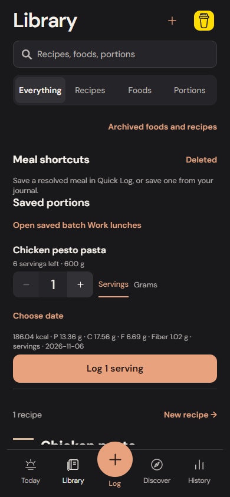
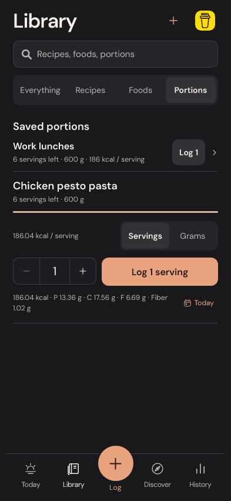
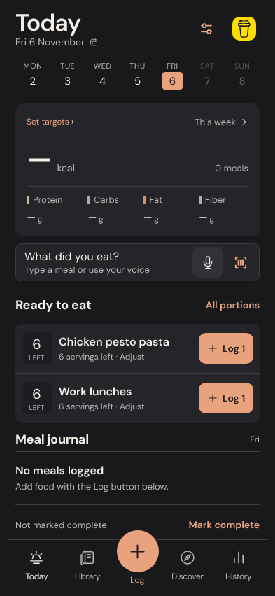

# Recipes and saved portions: finishing pass

The batch and recipe workflows share a compact quantity control with direct typing and 44-point step buttons. Stock-aware controls stop at the amount remaining. Manual overdraws remain editable and cannot be logged. Recipes show English source labels and preparation alongside the ingredient calories.

## Faster everyday actions

Measured in isolated Chromium at 390 × 844 and WebKit at 393 × 852, using two real-catalog fixture batches. Both browsers produced the same revised counts:

| Task | Before | After | User scrolls |
| --- | --- | --- | --- |
| Open a particular batch from Today | 2 actions | 1 action | 0 in both |
| Choose tomorrow in the batch review | 3 actions | 2 actions | 0 in both |
| Log a collapsed Library batch | 2 actions | 1 action | 0 in both |

The before paths use All portions then Open batch, date focus and entry, and opening a batch before logging it. The revised paths open the exact batch in the Portions tab, offer a Tomorrow shortcut, and log directly from a collapsed row. A full saved serving on Today remains one tap. Repeated navigation consumes the destination request so changing Library tabs or selecting another batch does not make the next Today shortcut open the wrong view.

Only one batch is expanded. Closed rows show their remaining stock and calories per serving. The expanded review brings the amount and Log action together, shows live calories/macros including fiber, and keeps its selected date visible. The Portions tab hides archive controls that apply only to foods and recipes; selecting it exits archive mode. Its empty state leads to real food entry.

## Exact portions

Switching servings and grams uses only the measured batch weight. Two servings of a six-serving, 600 g batch become 200 g, retaining their nutrition. A recurring result such as one serving of a six-serving, 1000 g batch is left blank for an explicit amount; no rounded portion is silently logged. Returning from a blank gram conversion retains the previous serving amount.

Today and collapsed Library rows offer one serving when available, or the exact final fraction. If the remaining serving fraction recurs but measured grams are exact, the shortcut uses those grams. Capacity and nutrition calculations remain the existing domain calculations. No cooking yield, absorption, density estimate or extra ingredient is introduced.

## Recipe drafts

A browser regression exposed the old 180 ms recipe-save delay: a fast reload could restore the previous serving count. Draft changes now enter the existing serialized save queue immediately. The editor shows Saving draft / Draft saved on this device / Draft needs saving near its name, and reports failed writes. The reload test waits for the actual save acknowledgement. Recipe templates are still saved explicitly; changing a template draft never rewrites a prepared batch or historical log.

## Cooking verification

The tested meal is `200g chicken breast, 150g dry pasta, 15g pesto, 10g olive oil, 50g parmesan`, with confirmed Matvaretabellen records and six servings. Batch nutrition is 1116.25 kcal, 80.155 g protein, 105.375 g carbohydrate, 40.115 g fat and 6.135 g fiber. Logging one serving stores each batch nutrient divided by six, before UI rounding. Saving the batch logs nothing; one serving leaves five. A subsequent two-serving log for tomorrow and Undo restore exactly the first log and original batch snapshot after reload.

Other checks cover measured/unmeasured batches, recurring unit conversion, a final half-serving shortcut, independent ingredient edits, recipe serving changes and draft reload, archive-mode navigation, and narrow layouts with 1.7× browser text enlargement. Browser text stress is not iOS Dynamic Type or VoiceOver validation. All fixtures and exports are isolated test data.

## Remaining limits

- Physical iPhone keyboard, interruption, offline and full restoration acceptance remain pending in the existing development app. No standalone build is created.
- At this milestone, unsent saved-batch amount/date controls were local screen state. The later [portion-draft continuity pass](PORTION_DRAFT_CONTINUITY.md) now preserves those edits; completed portions and stock continue to persist.
- Exact conversions must fit the supported six decimal places. An unrepresentable conversion requires an explicit amount rather than an estimate.
- A process killed before a successful save acknowledgement may interrupt a pending write. The save indicator does not claim otherwise.
- Custom dates use an inline YYYY-MM-DD field; Tomorrow is the new shortcut. No new screen or date-picker dependency is introduced.

## Actual implementation

Before, opening the chosen batch led to the Everything view:

After, the same action opens its compact Portions review directly:

Today retains one-action logging and opens the selected batch:

