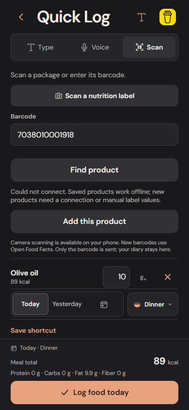
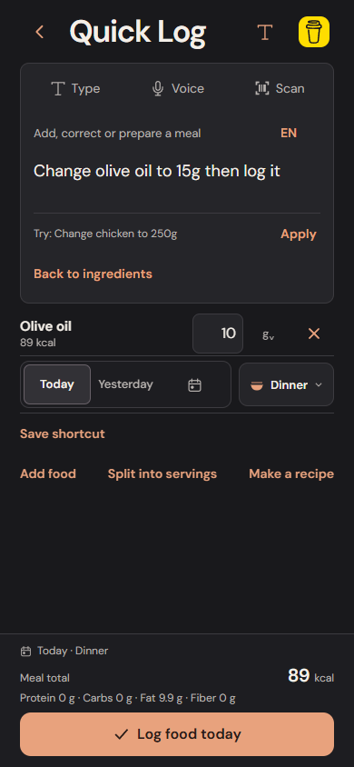

# Offline and interruption recovery

This pass fixes two reproduced failures without changing food data, nutrition calculations, storage formats or the normal logging interaction count.

## Interrupted automatic speech

A final transcript is saved before its command is applied. Previously, leaving Quick Log while that asynchronous save was being acknowledged could still execute the command afterward. The baseline browser test reproduced an unintended 15 g olive-oil log after leaving the screen.

Automatic speech now checks both its capture generation and foreground state after the transcript save, immediately before entering the command transaction. Leaving, changing entry mode, backgrounding or a recognition error invalidates that capture. The transcript remains saved; returning and explicitly applying it uses the existing command ID and atomic acknowledgement. It logs once and retains Undo.

An explicitly pressed Apply action remains an instruction to submit. A transaction already started while the capture was current completes atomically; this change does not attempt to undo a committed transaction when navigating away.

## Barcode lookup after a disconnection

Previously, attempts made without a connection consumed the local lookup allowance. Thirteen offline attempts reproduced a one-minute lockout even though no product record had been obtained.

The browser now uses its explicit offline signal to offer the existing saved-product/manual-label fallback immediately. Cached candidates still require their normal review. Browser and native connection failures before receiving an HTTP response release that attempt's local allowance, allowing immediate reconnection. Actual HTTP responses, including 429 and 5xx responses, and interrupted response bodies still count. The provider's 429 cooldown remains intact.

An online signal is not treated as proof that the product service is reachable. Normal network failure and timeout handling remain in place. Saved confirmed products continue to use local records and do not require a provider call.

## Verification

`offline-interruptions.spec.ts` holds only an IndexedDB transaction's completion acknowledgement, allowing its real atomic write to finish. Injected recognition transcripts then exercise leaving and a browser visibility interruption during the pending acknowledgement. The checks retain the original 10 g draft, keep the diary empty, reload the saved transcript, explicitly log the corrected 15 g amount once, and Undo it.

The barcode scenario performs thirteen offline attempts, checks that the meal and diary remain unchanged, reconnects and opens a real editable review using an isolated provider-response fixture. Unit tests cover explicit offline state, cache reuse, native-style network failures, HTTP errors and failures during response-body reading. Existing suites continue to cover saved-barcode offline logging, permission races, camera/picker cancellation and stale recognition callbacks.

The new product API fixture scenarios block service workers so request interception is deterministic. Separate existing readiness scenarios test the real offline shell; API fixtures do not establish live Open Food Facts availability.

Local focused checks pass in both Chromium and iPhone-sized WebKit. Full results are recorded in the draft PR and CI artifacts. The local pre-fix baseline reproduces both failures. Browser visibility events and fake speech results do not establish physical iPhone phone-call behavior, microphone accuracy, camera release or actual permission-prompt transitions. Those remain device checks in [the iPhone checklist](IPHONE_TESTING.md). Standalone builds remain postponed.

## Actual implementation

The original meal remains available to log while a new barcode needs a connection:

An interrupted transcript can be reopened and explicitly applied:

