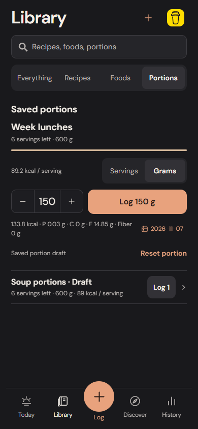

# Saved-portion draft continuity

Unfinished saved-batch reviews now retain their amount strings, unit and optional logging date per batch. Partial decimal commas, blank gram conversions and unfinished dates stay editable after switching batches or restarting. Nothing is eaten or deducted from stock when editing or restoring a draft.

## Recovery without repeated input

The old browser baseline entered 150 g for tomorrow, then reloaded: the controls returned to 1 serving for today. The new browser workflow restores 150 g, Grams and the selected date without re-entering any field. Today shows Resume draft, and collapsed Library batches mark saved drafts. The usual one-action Log 1 path remains available and does not consume a pending custom review.

Each editor waits for already-queued writes before loading its draft. Edits save immediately through the existing serialized preferences transaction. Saved / Saving / failure text distinguishes acknowledged persistence from an unfinished write. A failed write keeps the local review editable; logging retries directly from the visible values. A process killed before acknowledgement may still interrupt a pending write.

## Logging and reset

Logging a custom review validates the amount, measured-weight basis, date and current stock. The log snapshot, Undo state and consumed-draft marker commit in one transaction. If that transaction aborts, neither food nor the draft changes; retry logs one portion.

A successful custom log starts a fresh amount for the remaining stock and automatic Today, retaining the current screen unit where an exact conversion exists. Reset portion clears the unfinished review without changing food or stock. Consumed/reset markers reject delayed edits from an obsolete editor and take precedence over an older backup, so completed or discarded intent is not resurrected. Undo changes the logged food and stock without reviving the consumed draft.

Quick logs on Today or collapsed Library rows intentionally leave a custom draft alone. Its amount is revalidated against the new stock when reopened. Even an exhausted batch stays visible in Library while it has a pending draft; it cannot log past its stock and can be reset.

## Dates and units

Automatic Today is stored without a fixed date and follows the current day. The portion view refreshes at midnight and on foreground/focus. An explicitly typed or selected date stays on that calendar day, including after restart. Non-current dates use a day-only history timestamp rather than implying a known eating time.

Unit switching still uses only measured cooked weight. An unrepresentable conversion stays blank and the prior amount is retained for switching back. No cooking yield, density, oil absorption, ingredient or nutrient is inferred.

## Backups and compatibility

Portion reviews and cleared markers live in an optional quick-entry preferences field. The archive and storage versions stay at 2; older backups without that field still load. Existing entries, snapshots, templates, batches and nutrition values are untouched. Backups/recovery reviews count active portion drafts. Local drafts and explicit clears win during merge; a fresh store can restore the incoming unfinished reviews.

Imports and startup reject drafts pointing at missing batches or selecting grams without a measured weight. Partial editable quantities/dates are valid draft data, not valid permission to log. Historical batch identifiers keep their existing accepted length. Older app versions that refuse unsupported fields require an update before reading a new backup containing portion drafts.

## Verification boundaries

Unit tests cover automatic versus fixed dates, exact unit switches and preservation of incomplete input. Real SQLite and IndexedDB tests cover independent batches, actual close/reopen persistence, failed log/reset rollback, stale-write rejection, older-backup merge, quick-log stock changes, Undo and invalid stored references. Browser tests use actual catalog/repository/storage behavior, plus a real IndexedDB transaction abort; no production test hooks are added.

The browser suites also recheck six-serving nutrition and the previous meal-prep workflow. Browser focus/midnight behavior and desktop database tests do not establish physical iPhone suspension, Files restore or keyboard comfort. Those remain separate acceptance checks in the existing development app. No native dependency, cloud service or standalone build is added.

## Actual browser review

A restored portion draft remains editable, with its unit, selected day and current stock visible:

